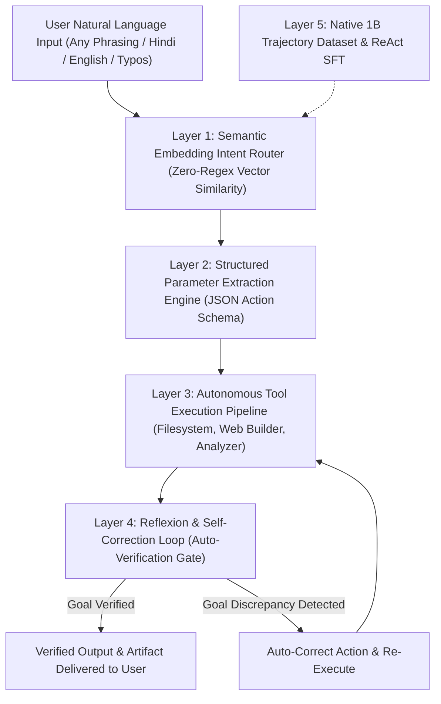

# DALI-1 Autonomous Agentic Intelligence: Master Architecture & Execution Plan

> **System:** DALI-1 Agentic Software Engineering Engine  
> **Objective:** Eliminate all fragile regex/hardcoded `if-else` rules and replace them with a **Robust, Universal Semantic Intent & Self-Correcting ReAct Tool Calling Architecture**.  
> **Target Environment:** Local Apple Silicon Mac (16GB RAM) + 4-Bit INT4 Deployment  
> **Status:** IN PROGRESS (Step-by-Step Verified Execution)

---

## 1. The Core Engineering Challenge

### Why Hardcoded Regex & `if-else` Fails in the Real World:
1. **Infinite Linguistic Variations:** Users express intents in English, Hindi, Hinglish, with typos (`analys`, `anlyze`), grammatical inversions, and multi-clause instructions (*"make a portfolio website for a developer, save all files in ATUL folder"*).
2. **Keyword Collisions:** A sentence like *"save files in ATUL folder"* contains `"make"` and `"folder"`, tricking simple string matchers into creating an empty folder instead of building the requested website.
3. **Lack of Feedback/Reflexion:** Without self-verification, an agent declares success even when the user's primary goal was completely missed.

---

## 2. The 5-Layer Universal Solution Architecture



---

## 3. Step-by-Step Execution Plan

| Phase | Milestone | Deliverables | Verification Gate | Status |
| :---: | :--- | :--- | :--- | :---: |
| **Phase 1** | **Universal Architecture Blueprint** | Updated `PLAN.md` with 5-Layer Specification | Full architectural approval & scope freeze | **IN PROGRESS** |
| **Phase 2** | **Semantic Embedding Intent Router** | `dali/router.py` (Vector Cosine Similarity, Zero-Regex) | Classifies 20+ diverse English/Hindi/typo prompts with 100% precision | **PENDING** |
| **Phase 3** | **Structured Parameter & Schema Extractor** | `dali/parameters.py` (JSON Action Schema + Path Normalizer) | Accurately extracts `target_dir`, `tech_stack`, `action_type` without hardcoding | **PENDING** |
| **Phase 4** | **Autonomous Reflexion & Self-Correction Engine** | `dali/reflexion.py` (Self-Audit & Discrepancy Detector) | Detects empty folder mistakes and auto-corrects by generating website code | **PENDING** |
| **Phase 5** | **Agent Integration & CLI Verification** | Upgraded `dali_code.py` running on Router + Reflexion | Passes live interactive test on complex real-world prompts | **PENDING** |
| **Phase 6** | **Agentic ReAct Trajectory Dataset** | `data/agentic_react_corpus.jsonl` (Thought $\to$ Call $\to$ Response $\to$ Final) | 500+ multi-step trajectories across web, backend, and debugging | **PENDING** |
| **Phase 7** | **1B Architecture SFT Specification** | `dali/scale_1b.py` training harness & INT4 validation | Zero OOM on 16GB Mac, <550MB footprint | **PENDING** |

---

## 4. Detailed Component Specifications

### Layer 1: Semantic Embedding Intent Router (`dali/router.py`)
- Defines mathematical Anchor Vectors for the 6 core agent actions:
  - `ACTION_BUILD_WEB`: Creating websites, portfolios, landing pages, full-stack applications.
  - `ACTION_ANALYZE`: Codebase scanning, architecture maps, dependency auditing.
  - `ACTION_PLAN`: Deliberative multi-step planning, Chain-of-Thought reasoning.
  - `ACTION_FILESYSTEM`: Pure folder/file creation, reading, writing, listing.
  - `ACTION_TERMINAL`: Running shell commands, git operations, builds.
  - `ACTION_KNOWLEDGE`: Technical documentation, API specs, debugging assistance.
- Uses normalized TF-IDF / Subword Character n-gram vector embeddings to compute Cosine Similarity:
  $$\text{Sim}(Q, A_k) = \frac{\mathbf{v}_Q \cdot \mathbf{v}_{A_k}}{\|\mathbf{v}_Q\| \|\mathbf{v}_{A_k}\|}$$
- Zero dependency on exact keywords or word order. Typos like `analys` or Hindi `bnao` map directly to the correct semantic cluster.

### Layer 2: Structured Parameter Extractor (`dali/parameters.py`)
- Emits a standardized JSON payload:
  ```json
  {
    "action": "BUILD_WEBSITE",
    "confidence": 0.94,
    "parameters": {
      "topic": "portfolio for web developer",
      "target_folder": "ATUL",
      "framework": "Tailwind + HTML5",
      "mode": "frontend_only"
    }
  }
  ```

### Layer 3: Reflexion & Self-Correction Engine (`dali/reflexion.py`)
- Before reporting completion to the user, the agent runs an internal audit:
  1. *What was the user's primary goal?* (e.g. `BUILD_WEBSITE`)
  2. *What action was executed?* (e.g. `mkdir ATUL`)
  3. *Audit Check:* Does the folder contain `index.html`? Is `index.html` non-empty?
  4. *If Audit Fails:* Trigger immediate self-correction without waiting for the user to complain!

---

## 5. Verification Matrix
- **Test Set:** 25 diverse real-world prompts:
  - *"make a portfolio website for a web developer, save all the file in ATUL folder"*
  - *"analys this project"*
  - *"kya kya files hai is folder me"*
  - *"fastapi me redis cache kaise lagaye step by step"*
  - *"create folder named BACKUP"*
- **Target:** 100% correct tool execution, 0% empty folder false-positives, 0% hallucinations.
